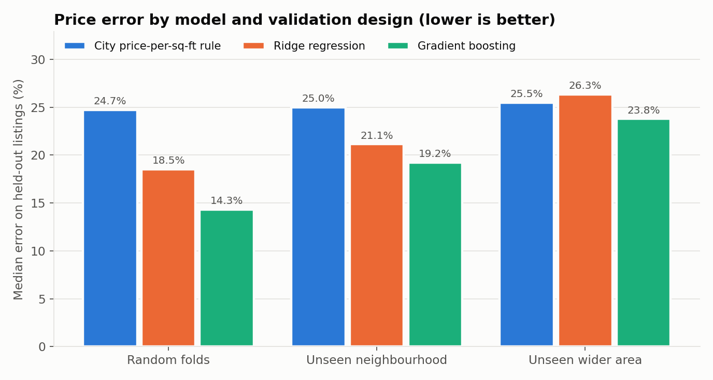
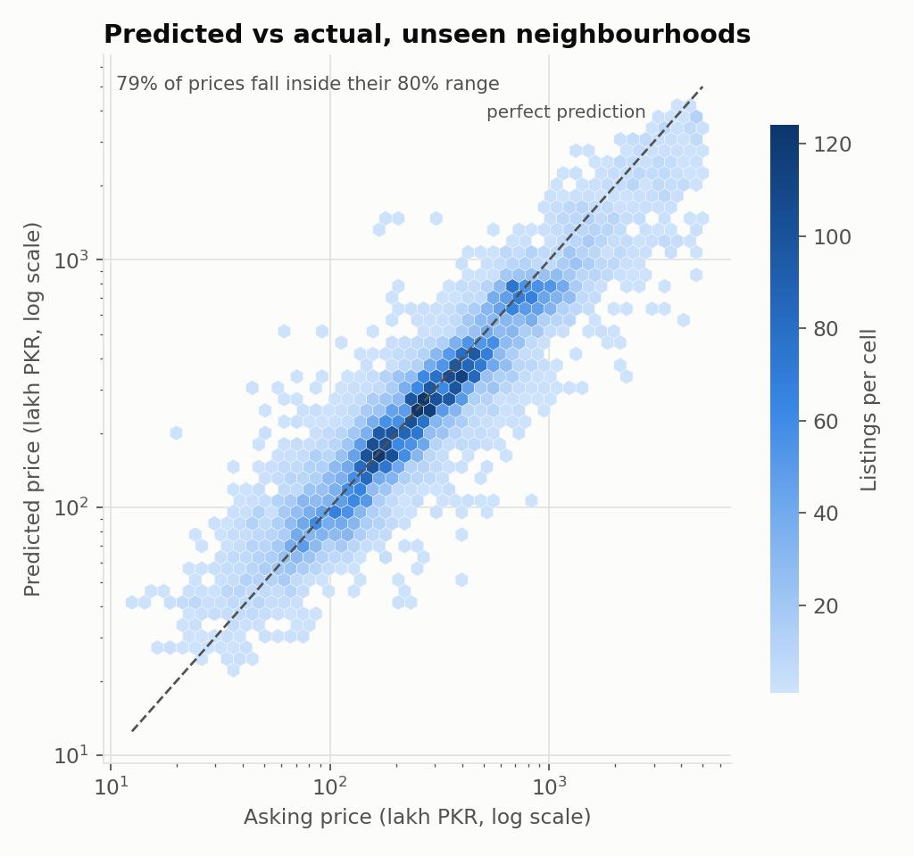
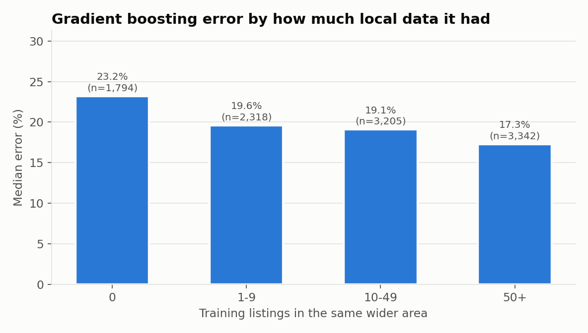

# Pakistan Housing Market: Analysis and Price Model

An in-depth analysis of **10,659 residential property listings** from [Zameen.com](https://www.zameen.com/), Pakistan's largest real estate platform, across 11 cities. Part 1 explores pricing patterns, geographic trends and property characteristics. Part 2 builds a **price model** that predicts a listing's asking price, gives an **80% price range** for it, and is validated on **neighbourhoods it has never seen**.

## Key Findings

- **Islamabad commands a 2–3x price premium** per sqft over tier-2 cities like Faisalabad and Multan. Sectors F-7, F-8, and E-7 are the most expensive neighborhoods in the country.
- **Location is the #1 price driver** — the same-sized home varies 5–10x in price by neighborhood alone. Bedrooms and bathrooms matter much less than size: within the same area and at the same size, one more bedroom adds about 6% and one more bathroom about 9% (see the hedonic regression below).
- **The market is family-home oriented** — 3–5 bedroom properties dominate listings. Studios and 1-beds are nearly absent, reflecting extended-family living norms.
- **Price distribution is heavily right-skewed** — median ~260 Lakh vs. a much higher mean. The bulk of the market sits between 50–500 Lakh; the luxury tail is thin and illiquid.

## Sample Visualizations

### Price Distribution (Log Scale)


### Median Price per Sqft by City


### Price/Sqft Heatmap — City x Bedroom Group


## Price Model

**Question:** given a listing's city, neighbourhood, size, bedrooms and bathrooms, what is a fair asking price, and how sure can we be?

### Results (5-fold cross-validation, whole neighbourhoods held out)

| Model | Median error | Within 20% of the asking price | R² (log price) |
|---|---|---|---|
| City price-per-sq-ft rule (what an agent would do by hand) | 25.0% | 41.8% | 0.78 |
| Ridge regression | 21.1% | 48.1% | 0.84 |
| **Gradient boosting** | **19.2%** | **51.9%** | **0.87** |

- **Price ranges are calibrated:** 79.5% of held-out prices fall inside their predicted 80% range. Without calibration, the raw quantile models covered only 73.3%.
- **Random splits would overstate accuracy:** the same model scores 14.3% median error with random folds, because it has already seen the test listing's neighbourhood. Holding out whole neighbourhoods is the honest test for pricing a listing somewhere new.
- **Local data matters:** error falls from 23.2% when the model has no listings from the same wider area to 17.3% with 50 or more.
- Weakest cities: Karachi and Islamabad (about 23–24% median error), Murree (29%). Quetta and Attock have too few listings (12 and 6) to judge.







### Hedonic regression (the economics view)

Log price on log size, bedrooms and bathrooms, comparing listings only within the same area (area fixed effects). 95% intervals come from a cluster bootstrap that resamples whole areas. 9,558 listings that state bedrooms and bathrooms, 839 areas.

| Effect | Estimate | 95% interval |
|---|---|---|
| 10% more floor area | +7.8% price | +7.2% to +8.4% |
| One more bedroom, same size | +5.6% | +4.1% to +7.2% |
| One more bathroom, same size | +8.6% | +6.8% to +10.3% |

The size elasticity of about 0.79 means price rises less than proportionally with size, so larger homes are cheaper per square foot within the same area.

### How it works

- **Target:** log of the asking price, so errors are relative and the long luxury tail does not dominate.
- **No leakage:** columns computed from the price (price in lakh, price per sq ft, price band) are dropped. Neighbourhood names repeat across cities ("DHA Phase 6, DHA Defence" exists in Lahore and Karachi), so every neighbourhood key carries its city. A listing's own price never feeds its own neighbourhood encoding (cross-fitted target encoding).
- **Missing values:** 0 bedrooms (928 listings) or 0 bathrooms (1,037) means "not stated". These are treated as missing and flagged rather than read as real zeros.
- **Validation:** `StratifiedGroupKFold` holds out whole neighbourhoods and keeps the city mix in every fold. Random folds and whole wider areas are reported for comparison.
- **Tuning:** a nested random search, grouped the same way, runs inside each training fold, so the test fold never influences the settings. Tuning made no real difference (19.2% median error tuned, 19.0% with the default settings), so the result does not depend on tuning against the test data.
- **Price ranges:** quantile gradient boosting (10th and 90th percentile), calibrated by split conformal prediction (conformalized quantile regression, Romano et al., 2019) on a held-out quarter of each training fold.
- **Interpretation:** permutation importance on held-out folds ranks size first by far, then the wider area and the city.

### Limitations

- These are **asking prices**, not sale prices, from one snapshot of Zameen.com listings (Kaggle dataset), so the model reflects sellers' expectations at that time.
- The data has **no property type** (house, flat, upper portion) and no age or condition, which explains part of the remaining error.
- Unseen neighbourhoods get wide ranges (median width about 80% of the prediction); the model is a first estimate, not a valuation.

## Tech Stack

- **Python 3.10+**
- pandas, NumPy — data wrangling
- matplotlib, seaborn — visualization
- scikit-learn — models, grouped cross-validation, nested tuning, permutation importance
- pytest — 23 tests for leakage, validation splits, intervals and the hedonic estimator
- Jupyter Notebook — interactive analysis

## How to Run

### 1. Clone the repository

```bash
git clone https://github.com/TalhaHamdees/pakistan-housing-eda.git
cd pakistan-housing-eda
```

### 2. Create a virtual environment (recommended)

```bash
python -m venv venv
source venv/bin/activate        # Linux/Mac
venv\Scripts\activate           # Windows
```

### 3. Install dependencies

```bash
pip install -r requirements.txt
```

### 4. Download the dataset

Download the [Zameen.com Housing Prices dataset](https://www.kaggle.com/datasets/huzzefakhan/zameen-property-dataset) from Kaggle and place the CSV file at:

```
data/raw/archive_2/zameen.csv
```

### 5. Launch the notebook

```bash
jupyter notebook notebooks/01_eda_analysis.ipynb
```

Run all cells top-to-bottom (**Kernel → Restart & Run All**). The notebook handles all cleaning, feature engineering, and visualization from the raw CSV.

### 6. Run the price model

```bash
python -m pytest                  # 23 tests
python src/run_analysis.py        # full run with nested tuning (about 6 minutes)
python src/run_analysis.py --quick
```

Results go to `reports/price_model_results.md` and charts 11–13 in `images/`.

## Project Structure

```
pakistan-housing-eda/
├── data/
│   ├── raw/                        # Raw CSV from Kaggle (not tracked)
│   └── cleaned_housing_data.csv    # Cleaned dataset (generated by notebook)
├── images/                         # Exported chart PNGs
├── notebooks/
│   └── 01_eda_analysis.ipynb       # Main analysis notebook
├── src/
│   ├── price_model.py              # Data prep, validation splits, models, intervals, hedonic model
│   └── run_analysis.py             # Runs the analysis, writes the report and charts 11-13
├── tests/
│   └── test_price_model.py         # 23 tests
├── reports/
│   └── price_model_results.md      # Full results tables
├── pytest.ini
├── requirements.txt
└── README.md
```

## Dataset

- **Source:** [Zameen.com Property Dataset (Kaggle)](https://www.kaggle.com/datasets/huzzefakhan/zameen-property-dataset)
- **Format:** Pipe-delimited CSV (`|`)
- **Size:** ~16,000 raw listings → 10,659 after cleaning
- **Features:** city, price, location, bedrooms, bathrooms, area (sqft)
